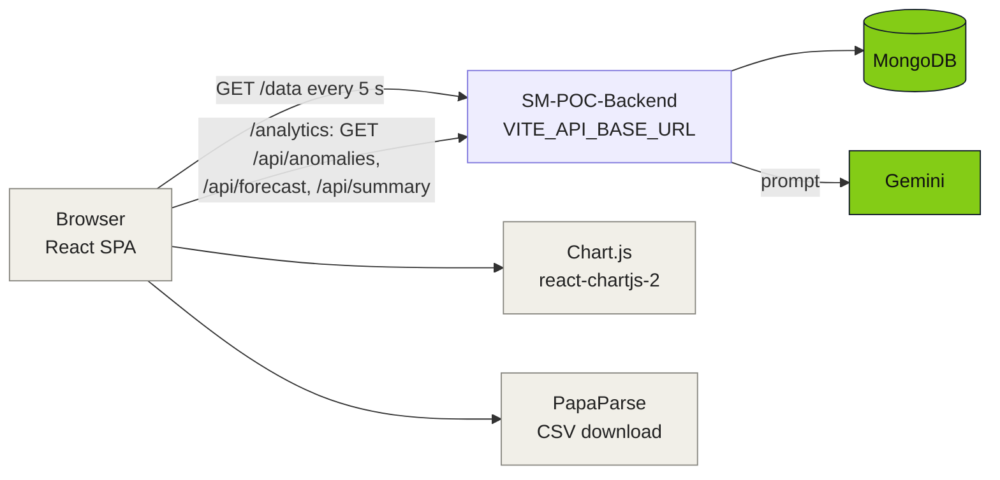

<div align="center">


<a href="#-how-it-works"></a>

<br/>

[](src/main.jsx)
[](vite.config.js)
[](src/components)
[](src/main.jsx)
[](vercel.json)
<br/>
[](#-status-and-known-limitations)
[](LICENSE)

</div>

---

##  Project Overview

The web dashboard of a smart-meter proof of concept (September 2025). It polls the API in [SM-POC-Backend](https://github.com/mukesh-dev-git/SM-POC-Backend) every 5 seconds and shows the latest voltage, current, power and energy, charts of the last 50 readings, the LoRa signal strength and a few threshold alerts. A second page shows anomaly and forecast charts and an AI-written summary produced by the backend.

### Key Features

-  **Live metrics**: four cards (V, A, W, Wh) and four line charts, refreshed every 5 seconds.
-  **RSSI gauge**: half-doughnut from -120 to -30 dBm, green above -65, amber above -80, red below.
-  **Automated alerts**: low voltage (below 215 V), high current (above 10 A) and weak LoRa signal (below -85 dBm), checked in the browser against the latest reading.
-  **Anomalies**: power over the last 24 hours with detected spikes marked as points.
-  **Forecast**: last 6 hours of power followed by the predicted values as a dashed line.
-  **Gemini summary**: the backend's text shown at the top of the analytics page.
-  **CSV export**: pick a date range and download the matching readings with PapaParse.

##  How It Works



Two routes, set up in `src/main.jsx`:

| Route | Page |
|---|---|
| `/` | Live dashboard (`App.jsx`) |
| `/analytics` | Anomalies, forecast and AI summary (`pages/AnalyticsPage.jsx`) |

The app is a single-page app; `vercel.json` rewrites every path to `index.html` so deep links work on Vercel. All calls use `fetch` against `VITE_API_BASE_URL`. There is no login.

##  Quick Start

You need Node.js and a running [SM-POC-Backend](https://github.com/mukesh-dev-git/SM-POC-Backend) (the original hosted one is gone).

```bash
git clone https://github.com/mukesh-dev-git/SM-POC-Frontend.git
cd SM-POC-Frontend
npm install
cp .env.example .env.local   # VITE_API_BASE_URL=http://localhost:3001
npm run dev                  # http://localhost:5173
```

```bash
npm run build     # production build in dist/
npm run preview
npm run lint
```

Notes:

- `VITE_API_BASE_URL` is baked in at build time. The repo's `.env.production` points at the old Render backend, so replace it (or set the variable in your host) before building.
- `vite.config.js` proxies `/api` to the old Render URL, but not `/data`. Set `VITE_API_BASE_URL` to your backend, which allows CORS from any origin, instead of relying on the proxy.

##  Project Structure

```
SM-POC-Frontend/
├── src/
│   ├── main.jsx                  # router, Chart.js registration
│   ├── App.jsx                   # live dashboard, 5 s polling
│   ├── pages/AnalyticsPage.jsx   # anomalies, forecast, AI summary
│   ├── components/
│   │   ├── MetricCard.jsx        LineChart.jsx   RssiGauge.jsx
│   │   ├── InsightsPanel.jsx     # threshold alerts
│   │   ├── AnomalyChart.jsx      ForecastChart.jsx
│   │   └── DataExporter.jsx      # CSV export
│   └── index.css, App.css
├── vite.config.js                # dev proxy for /api
├── vercel.json                   # SPA rewrite
├── .env.example
└── package.json
```

##  Status and Known Limitations

A proof of concept that was deployed on Vercel and is now offline.

| Area | State |
|---|---|
| Live dashboard, RSSI gauge, alerts | Working against the backend |
| Anomaly and forecast charts | Only show data if the backend's `anomalies` and `forecasts` collections were filled by an outside job; the forecast chart stays on "Loading forecast data..." when there is no forecast |
| Analytics page errors | If a request fails, the page throws while reading `forecastData.forecast` instead of showing a message |
| CSV export | Covers only the 50 readings the dashboard has loaded; both date pickers start at the current moment, so the default range is empty |
| Alert thresholds | Fixed in `InsightsPanel.jsx` (215 V, 10 A, -85 dBm) |
| Page title, icon | Still the Vite defaults |
| Tests | None |

### External services

| Service | Used for | State |
|---|---|---|
| Vercel (`sm-poc-frontend.vercel.app`) | Hosting | Gone: returns 404 `DEPLOYMENT_NOT_FOUND` |
| Render (`sm-poc-backend.onrender.com`) | API host in `.env.production` and the dev proxy | Gone: returns 404 with `x-render-routing: no-server` |

The frontend uses no database or API key of its own; those belong to the backend.

##  Related Repositories

- [SM-POC-Backend](https://github.com/mukesh-dev-git/SM-POC-Backend): the Express + MongoDB API this app calls.
- [LoRa-ESP32](https://github.com/mukesh-dev-git/LoRa-ESP32) and [PowerMET](https://github.com/mukesh-dev-git/PowerMET): the gateway and the meter node that produce the readings.
- [SM-Dev1](https://github.com/mukesh-dev-git/SM-Dev1): a later STM32L432 + Wio-E5 LoRaWAN bring-up for the same smart-meter idea. It does not feed this dashboard.

##  License

MIT. See [LICENSE](LICENSE).

<div align="center">


</div>
